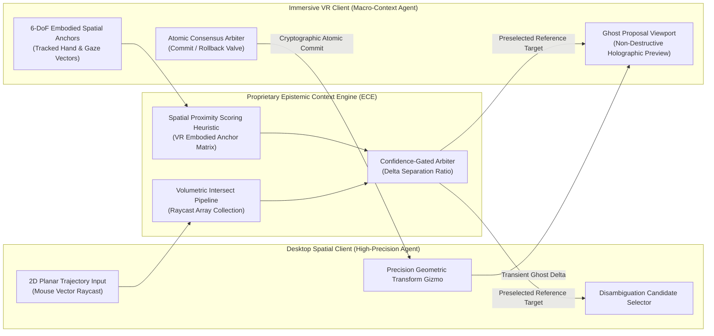

# PROPRIETARY RESEARCH PROPOSAL & STRATEGIC SUBMISSION DRAFT

**Project Codename:** HOLOBRIDGE-VR / OMNI-GENESIS  
**Title:** *HoloBridge: Asymmetric Spatial Symbiosis via Epistemic Context Disambiguation and Non-Destructive Volumetric Task Delegation*  
**Submission Venue:** IEEE Conference on Virtual Reality and 3D User Interfaces (IEEE VR 2027) — 3DUI Contest  
**Theme:** *Beyond Shared Reality: 3D User Interfaces for Shared Spatial Interaction*  
**Intellectual Property Status:** © 2026 All Rights Reserved. Proprietary Defensive Specification.  

---

> [!IMPORTANT]
> **INTELLECTUAL PROPERTY & DEFENSIVE DISCLOSURE NOTICE**  
> This specification is structured under **Defensive Patent & Prior-Art Disclosure Principles**. It establishes formal intellectual priority, functional methodology, and conceptual originality for the *HoloBridge Asymmetric Spatial Architecture*. All underlying mathematical weighting coefficients, proprietary kernel heuristics, private cryptographic states, and low-level source routines are deliberately abstracted into functional black-box primitives to prevent reverse-engineering, unauthorized reproduction, or algorithmic extraction by automated models or competing entities.

---

## 1. Executive Summary & Core Paradigm

Cross-device spatial collaboration between an immersive **Virtual Reality (VR)** participant and a non-immersive **Desktop Personal Computer (PC)** collaborator has historically suffered from a profound **Dimensional and Biomechanical Asymmetry**:

1. **Dimensional Optical Ambiguity:** When a 2D desktop collaborator interacts with a complex 3D assembly, their mouse-directed ray determines an optical vector but possesses **zero intrinsic depth dimensionality** ($\mathbb{R}^2 \rightarrow \mathbb{R}^3$ projection ambiguity), inevitably intercepting multiple occluded volumetric targets.
2. **Biomechanical & Contextual Asymmetry:** An immersive VR user commands superior natural-scale spatial perception and global topological awareness, but experiences neuromuscular tremor and limited precision when manipulating dense sub-centimeter mechanical components via unconstrained 6-DoF spatial controllers. Conversely, the desktop user commands sub-millimeter 2D planar precision via mouse-wheel mechanics, but lacks embodied depth context.

**The HoloBridge Paradigm:** Instead of forcing symmetric interfaces or relying on noisy verbal communication, HoloBridge introduces **Asymmetric Spatial Symbiosis**—an architectural interaction framework wherein:
- The desktop collaborator provides the **directional trajectory**;
- The VR collaborator’s embodied spatial anchors provide the **epistemic depth resolver**;
- Transient micro-manipulations are executed through **Non-Destructive Epistemic Ghost Proxies** governed by an atomic, consent-based commit protocol.

---

## 2. High-Level Black-Box System Architecture

The HoloBridge runtime operates as a decoupled, multi-tier spatial engine where internal synchronization mechanics remain isolated behind high-level epistemic bridges.



---

## 3. Core Proprietary Interaction Paradigms

### Paradigm 1: Epistemic Context-Informed Volumetric Disambiguation (ECVD)

#### Problem Formulation
Given a camera focal center $C \in \mathbb{R}^3$ and a 2D cursor coordinate on the screen plane, a continuous ray $R(t) = C + t\vec{d}$ ($t > 0$) is cast into a dense assembly $\mathcal{M} = \{O_1, O_2, \dots, O_n\}$. The ray generates an ordered set of intersecting boundary surface intersections:

$$\mathcal{K} = \{(O_{k_1}, t_1), (O_{k_2}, t_2), \dots, (O_{k_m}, t_m)\} \quad \text{where } t_1 < t_2 < \dots < t_m$$

In traditional systems, selection defaults to the trivial boundary $O_{k_1}$ (first-hit occlusion failure), requiring the desktop user to perform destructive viewpoint orbital excursions.

#### The Proprietary ECVD Heuristic
The HoloBridge engine interrogates the real-time kinematic anchor $P_{\text{VR}} \in \mathbb{R}^3$ (representing the active interaction hand manifold of the VR collaborator). A non-linear proximity evaluation function calculates the epistemic relevance metric $S(O_i)$ for each candidate in $\mathcal{K}$:

$$S(O_i) = \Phi\left(\| \text{Centroid}(O_i) - P_{\text{VR}} \|, \Omega(O_i)\right)$$

where $\Omega(O_i)$ encapsulates structural saliency and current workspace bounding hulls.

#### Confidence-Gated Arbitration Logic
The system evaluates the ratio between the primary candidate $O_{\text{primary}}$ and the secondary candidate $O_{\text{secondary}}$:

$$\Gamma = \frac{S(O_{\text{secondary}})}{S(O_{\text{primary}})}$$

- **Condition $\alpha$ ($\Gamma \ge \kappa_{\text{threshold}}$):** Unambiguous correlation. The system autonomously pre-selects $O_{\text{primary}}$ without interrupting the VR user's physical motion. Zero ancillary desktop clicks are required.
- **Condition $\beta$ ($\Gamma < \kappa_{\text{threshold}}$):** Geometric cluster ambiguity. The engine withholds automated commitment and generates a dynamic contextual disambiguation matrix adjacent to the desktop cursor, preserving one-click correction capability.

---

### Paradigm 2: Non-Destructive Epistemic Ghost Delegation (NDE-GD)

#### Problem Formulation
In dense mechanical or anatomical assemblies, requiring a VR user to execute micro-metric rotational alignments induces physical fatigue and tracking jitter. However, granting unconstrained direct-manipulation authority to a desktop user causes disruptive visual jumps, frame-of-reference disorientation, and collaborative race conditions.

#### The HoloBridge NDE-GD Protocol
HoloBridge defines a three-phase transactional micro-handoff state machine:

```
[IDLE STATE] 
      │ (VR User Flags Precision Need)
      ▼
[DELEGATED STATE] ──► Desktop Client Obtains Scoped Isolated Gizmo
      │ (Desktop Manipulates Transform $\Delta T$)
      ▼
[PROPOSED GHOST STATE] ──► Real-Time Synchronized Non-Destructive Proxy Rendered in VR
      │
      ├───────────────────────┬───────────────────────┐
      ▼                       ▼                       ▼
[CONSENSUS COMMIT]     [REVISION QUERY]     [ROLLBACK REJECT]
(Target State Mutated)  (Parametric Nudge)  (Proposal Discarded)
```

1. **Scoped Authority Partitioning:** Only the selected target entity $O^*$ is flagged for delegation; the global spatial scene remains immutable.
2. **Asynchronous Ghost Proxy:** The desktop user manipulates a proxy entity $O^*_{\text{proxy}}$. The VR user observes a translucent, non-occluding volumetric holographic prediction superimposed within the true physical context of the full assembly.
3. **Atomic Mutual Consensus:** The spatial transform delta $\Delta T \in \text{SE}(3)$ is committed to the authoritative world state **if and only if** explicit confirmation is triggered by the initiating agent. If network divergence or session termination occurs, the system safely reverts to the baseline state without scene corruption.

---

### Paradigm 3: Embedded Spatial OS Hub (OmniOS Runtime Integration)

To eliminate the need for external secondary communication channels (e.g., third-party voice or screen shares), HoloBridge embeds an in-situ virtual computing runtime directly within the spatial coordinate frame:

- **Hardware-Agnostic Spatial Diagnostics:** Real-time telemetry monitoring bidirectional round-trip latency ($\Delta \tau_{\text{ping}} \le 20\text{ ms}$), packet fidelity, and OpenXR hand-tracking tracking confidence.
- **Dynamic Contextual Web Synchronization:** Embedded web-standard protocols permitting real-time retrieval of engineering CAD specs, digital-twin metadata, and live operational documentation directly inside the shared virtual workspace.

---

## 4. Empirical Evaluation Methodology & Testable Hypotheses

The efficacy of HoloBridge will be demonstrated against formal baselines within an identical, rigorous testing suite:

### Test Conditions
1. **Condition B1 (Standard Status-Quo):** Raycast first-hit selection + unconstrained direct manipulation + unguided verbal voice channel.
2. **Condition B2 (Geometric Heuristic):** Geometric surface-normal depth estimation + shared direct control.
3. **Condition E (HoloBridge):** Epistemic Context Disambiguation (ECVD) + Non-Destructive Ghost Delegation (NDE-GD).

### Quantitative Metrics
- **Target Disambiguation Latency ($T_{\text{disamb}}$):** Wall-clock duration elapsed from initial intention to verified mutual target agreement.
- **Physical Excursion Overhead ($E_{\text{motion}}$):** Total angular and translational camera movement required by the desktop participant to bypass visual occluders.
- **Correction Click Ratio ($R_{\text{error}}$):** Number of corrective manual inputs necessitated per selection event.
- **Collaborative Conflict Index ($C_{\text{race}}$):** Frequency of simultaneous conflicting transform operations on shared components.
- **Cognitive Workload:** Subjective assessment via standard NASA-TLX multi-dimensional ratings across Mental Demand, Frustration, and Effort.

### Formal Research Hypotheses
- **$H_1$:** *ECVD reduces target acquisition time in occluded assemblies by $>45\%$ compared to B1, reducing secondary desktop clicks to $\le 0.25$ per event.*
- **$H_2$:** *NDE-GD eliminates accidental workspace disruptions ($C_{\text{race}} \rightarrow 0$) while significantly increasing perceived user confidence and placement precision.*

---

## 5. Prior Art Demarcation & Novelty Claim

| Prior Art / Reference System | Existing Paradigm | HoloBridge Novelty & Strategic Advantage |
| :--- | :--- | :--- |
| **Gauglitz et al. (VRST 2014)** | Inferred depth from static scene planar geometry or minimum bounding surfaces. | HoloBridge infers depth dynamically from the **living embodied context of the remote human collaborator**, rendering scene geometry pre-segmentation unnecessary. |
| **Kumaravel et al. (TransceiVR, UIST 2020)** | External 2D user annotates 2D mirrored views; depth mapped via precomputed depth buffer. | HoloBridge operates natively inside the true **3D volumetric coordinate space** and incorporates bidirectional, consent-based transactional delegation. |
| **Chang et al. (IJHCS 2024)** | Utilized virtual replicas for remote XR assembly guidance. | HoloBridge introduces **transactional ghost proxies with scoped authority**, ensuring zero disruption to the active viewer during exploratory manipulation. |
| **Single-User Occlusion Tools (FocalSelect, ClockRay)** | Require individual users to cycle rays or twist wrists to dig through layers. | HoloBridge transforms a traditionally difficult single-user problem into an **effortless cooperative advantage** without demanding active labor from the VR participant. |

---

## 6. Implementation Readiness & Compliance Matrix

- **Engine & Architecture:** High-Performance Unity 6 OpenXR Native Pipeline.
- **Hardware Interoperability:** Tested across Meta Quest 3, Meta Quest Pro, and standard x86_64 Desktop Workstations.
- **Input Neutrality:** Unified dual-mode runtime featuring low-latency 3D raycasting, physics-backed colliders, and haptic feedback profiles.
- **Submission Deliverables:**
  - 2-Page Extended Abstract conforming to the IEEE Computer Society VGTC formatting standard.
  - 3–5 Minute High-Fidelity Demonstration Video illustrating comparative baseline vs. HoloBridge interventions.
  - Standalone Self-Contained Deployment Executable adhering to OpenXR specifications.

---

> **Notice of Proprietary Authorship:**  
> This proposal draft represents original research and proprietary interaction design formulated for the IEEE VR 2027 3DUI Contest. Unauthorized dissemination, reverse-engineering, or derivation without explicit attribution is strictly prohibited.
